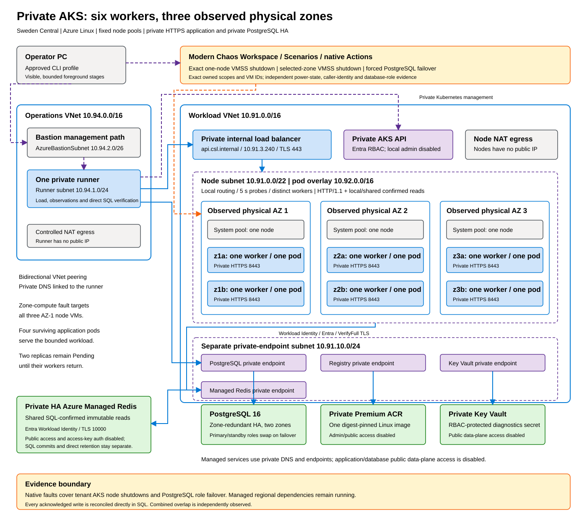

# AKS results

[Executive summary](executive-summary.md) | [Method](method.md) | Previous: [App Service results](app-service-results.md) | Next: [Container Apps results](container-apps-results.md)

App Service only let us crash processes. To remove real compute capacity we moved the same application to AKS, where Chaos Studio can shut down the virtual machines under the workload: one exact node, or every lab-owned node in one zone, for at least five continuous minutes.

## Architecture

The Sweden Central cluster (AKS 1.35.9, Azure Linux 3.0, Standard tier) has three system nodes and six single-node user pools, two per zone, with autoscaling disabled so capacity stays fixed. Six .NET 10 pods run one per user node, enforced by hard hostname anti-affinity. Clients reach them through a private internal load balancer with `externalTrafficPolicy: Local` and a 5-second, two-probe health check. PostgreSQL 16 uses zone-redundant HA. The final version also reads SQL-confirmed immutable orders from a bounded local cache and a private HA Azure Managed Redis before querying PostgreSQL; every write still commits in PostgreSQL first.

The single-node pools make the fault precise. Shutting down pool `z1a` removes exactly one application pod; shutting down the zone-1 system pool and `z1a`/`z1b` removes all lab compute in zone 1, while four pods in zones 2 and 3 keep serving.

## How the results improved

The first run exposed real weaknesses, and each was fixed before the next measurement. The table follows one version at a time.

| Version | Change | Node shutdown | Zone-compute shutdown | PostgreSQL failover |
| --- | --- | --- | --- | --- |
| Original | none | FAIL: first 5 min 98.95% | FAIL: first 5 min 97.85% | FAIL: 98.01% full phase |
| Repair 1 | one pod per host, Local routing, HTTP/1.1, per-pod read cache | **PASS**: first 5 min 100%, full phase 99.963% | **PASS**: first 5 min 100%, full phase 99.949% | FAIL: 99.380% |
| Repair 2 (final) | shared Redis read cache, k6 virtual users preallocated | not rerun | not rerun | Business 100%, overall INCONCLUSIVE |

Let's read it with the best results first. With repair 1, an exact node stayed powered off for at least 304 seconds and three zone-1 nodes for at least 305 seconds. In both cases the first five minutes after the shutdown had 100% business success and a 10 ms p95; across 18 minutes only 8 (node) and 11 (zone) business operations failed, all in the transition. Service met its recovery window within one second of the observed power-off, and six pods returned to six distinct workers in three zones without manual action.

The final database run completed all 21,600 scheduled business operations successfully, with no business drops and a 13 ms p95; 413 attempts failed and were retried to SQL-confirmed success. Two facts keep it from a PASS: the independent topology observer stopped after 20 samples when one Azure Resource Manager request exceeded its 10-second timeout, and 22 scheduled canary checks were dropped when the canary's 10 virtual users were all waiting on writes. Repair 2 was not rerun against node, zone or combined faults, so no single version has passed the complete suite.

Direct PostgreSQL reconciliation, bypassing both caches, found all 78,142 acknowledged measurement writes across 21 runs.

## Findings worth keeping

- **One pod per node and node-local routing.** In the original run, a rescheduled pod landed beside another, leaving five workers for six pods. Hard anti-affinity keeps the replacement Pending until its node returns, and `externalTrafficPolicy: Local` with fast health probes stops the load balancer from forwarding to a dead node.
- **HTTP/2 connections lingered on dead nodes.** Node loss produced recurring 8-second transport failures; with HTTP/1.1 and the per-pod cache, failed attempts during node loss fell from 458 to 10. The two changes were made together, so their individual effect is unmeasured.
- **Cold replicas need a shared cache during failover.** With per-pod caches, reads failed on pods that had never seen the requested order. The shared Redis layer removed those failures.
- **Load generators must preallocate.** k6 created virtual users during the failover and dropped 51 scheduled operations; preallocating the existing 200 + 10 removed the business drops without raising any limit.
- **Defender for Containers created a public telemetry workspace.** Enabling the cluster's security profile caused Defender to create a default Log Analytics workspace, with public ingestion and query, outside the lab's resource groups. Private workload paths remained private, but security telemetry did not.

## What the evidence supports

AKS with one pod per node, local routing and HTTP/1.1 tolerates sudden loss of one node or of all lab nodes in one zone with almost no client impact. With a shared cache for confirmed reads, PostgreSQL failover no longer causes business errors. The shutdowns stop tenant virtual machines; the managed load balancer, PostgreSQL, Redis and the rest of the zone's infrastructure keep running, so this remains a compute-loss test.
