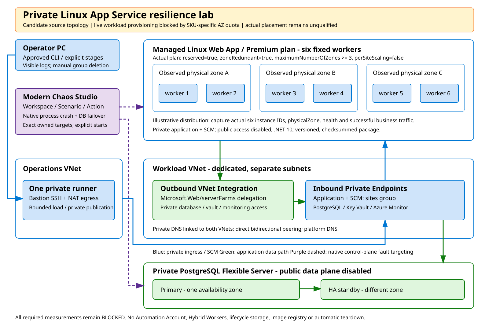

# App Service results

[Executive summary](executive-summary.md) | [Method](method.md) | Next: [AKS results](aks-results.md)

App Service ran the order API on six managed workers in Spain Central. The questions were simple: if the application process on one worker, or on every worker in one zone, crashes, do the other workers keep serving? And when PostgreSQL fails over to its standby, how long do clients see errors, and does every acknowledged write survive?

## Architecture

The plan used P1v3 with `zoneRedundant=true` and six fixed workers, observed as two workers in each of three physical zones. Clients reached the app through a Private Endpoint; outbound VNet Integration reached PostgreSQL 16 with zone-redundant HA, primary and standby in different zones. One private runner generated load, and the Chaos Studio Workspace ran from Sweden Central.

Chaos Studio offers a native *Kill process* Action for App Service. On Linux every tested runtime (.NET 8, .NET 9, Node.js 22) rejected it: listing worked, deletion returned HTTP 400 `This runtime stack is not yet supported on Linux`, and accepted executions failed with `ScenarioExecutionActionFailedError`. We therefore built a Windows variant with the same plan shape, private paths and database, running .NET 9 out of process. The results below come from that variant on 6 November 2026.

## Results

Each fault case ran under constant load: 20 business operations per second (80% reads, 20% writes) plus one read/write canary per second.

| Phase | Successful business ops | Failed | Dropped | Business success | Successful p95 | Recovery |
| --- | ---: | ---: | ---: | ---: | ---: | ---: |
| Baseline, 10 min | 12,001 | 0 | 0 | 100% | 123 ms | |
| Kill process on one exact worker, 12 min | 14,401 | 0 | 0 | 100% | 122 ms | |
| Kill process on both workers in one zone, 12 min | 14,401 | 0 | 0 | 100% | 121 ms | |
| PostgreSQL forced failover, 18 min | 21,028 | 414 | 159 | 97.347% | 123 ms | 36.4 s |
| Failover plus process kill, 18 min | 21,023 | 429 | 149 | 97.324% | 121 ms | 35.0 s |

Let's read the table from the top. After a process kill, App Service started a replacement process 12.7 seconds later on the same worker (11–13 seconds for the two workers in the selected zone), and no client request failed, because the load balancer kept sending traffic to the four or five healthy workers. The database cases behave differently: every worker depends on the same primary, so during the failover all of them return errors until connections reach the promoted standby. Service recovered in about 35 seconds and the following five minutes were stable, but the errors and dropped operations concentrated in that interval bring the 18-minute business success to 97.3%. In the combined case, independently observed database errors bracketed every process replacement, which proves the two faults overlapped.

Reconciliation found all 22,424 acknowledged writes from these phases and their 5-minute warmup, each with its expected checksum.

## Findings worth keeping

- **Npgsql 10 on Windows needs `GssEncryptionMode.Disable`.** The default `Prefer` probes Kerberos/SSPI before each physical connection; on Windows App Service that probe took 4.7–5.1 seconds and exceeded the 3-second database deadline. Disabling it brought physical opens to 0.22–0.60 seconds with VerifyFull TLS and Entra tokens unchanged.
- **The platform rebalances instances across zones at any time.** One replacement before injection invalidated an exact-instance baseline; every fault case therefore starts with a fresh instance-set check.
- **Subscription governance can change lab resources overnight.** Between 23:00 and 23:50 UTC an external automation stopped PostgreSQL, disabled Always On, downgraded the plan and deallocated the runner. Each run checks these settings first.
- **Linux App Service has no usable native application fault.** Process-crash resilience on Linux remains untested by Chaos Studio; on Linux .NET 9 the database failover measured 97.62% business success and 32.3 seconds recovery, consistent with Windows.

## What the evidence supports

Process crashes on one worker or one zone's workers are fully absorbed by the remaining capacity. PostgreSQL failover recovers automatically within about 35 seconds with no data loss, while the application without a read cache shows a visible error burst during the role change. The process faults leave the workers' hosts running. The recorded .NET 9 support deadline was 10 November 2026; a rerun needs a supported runtime.
