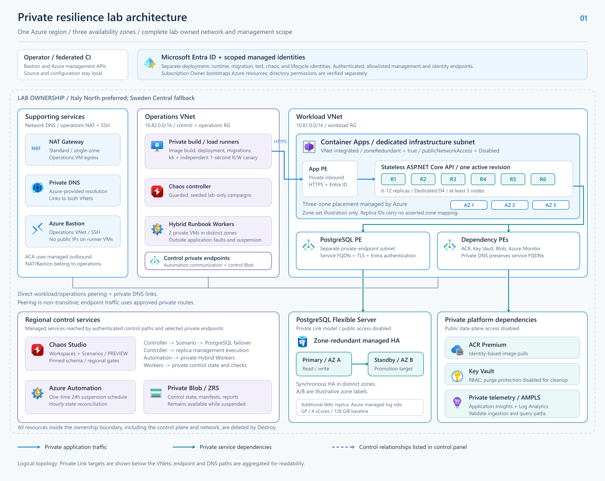
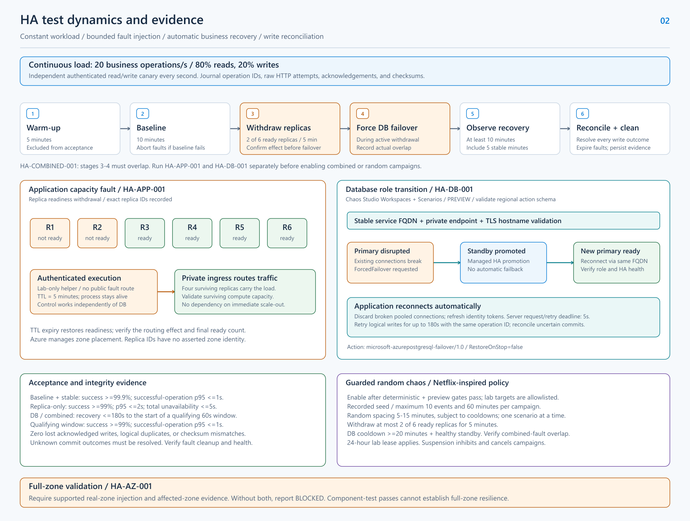
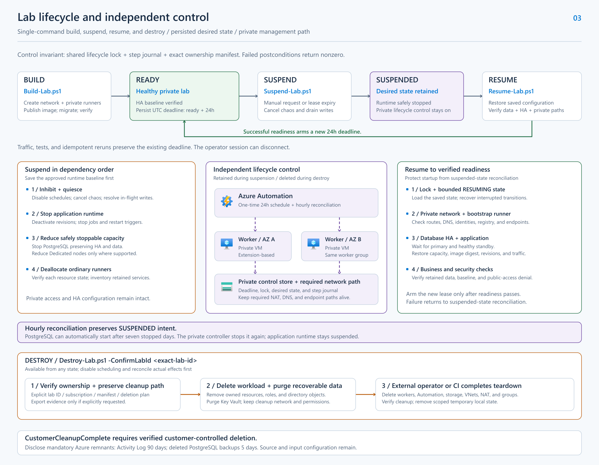

# Historical Container Apps architecture and operating guide

> **Superseded design walkthrough.** The text and three diagrams below describe the earlier Container Apps/Automation laboratory. The current [App Service specification](specification.md) and [D17-D19](../DECISIONS-ACCEPTED.md#d17-private-azure-app-service-across-three-zones) require private App Service across three observed zones, retained PostgreSQL HA, local deployment, manual deletion and modern Chaos Workspaces. These drawings do not establish App Service placement or implementation readiness and must be redrawn during the source refactor. Historical commands are not instructions for the new deployment.

This guide explains how the lab's private architecture, resilience experiments, and lifecycle work together. Follow the three diagrams in order: first trace a business request, then observe how faults affect that request, and finally examine how the environment is suspended, restored, and removed.

**Implementation status:** infrastructure, application, test and lifecycle code exist and pass local checks. D14 simplifies networking and D15 constrains the temporary policy exemption. D16's Sweden Central retry has live healthy cross-zone PostgreSQL and owned identities; the complete private deployment and application/failover/lifecycle tests require their separate execution evidence. See the [execution report](first-cycle-results.md) for measured outcomes.

The [implementation specification](specification.md) defines the detailed contracts. The [accepted decisions](../DECISIONS-ACCEPTED.md) record the approved choices, and [research and technical constraints](research.md) provide platform references and limitations.

## 1. The question the lab answers

Consider an order API that acknowledges a write only after PostgreSQL commits it. If application capacity disappears or the database primary fails, clients can experience broken connections, failed requests, or timeouts. The lab measures whether the application recovers automatically while preserving every acknowledged write.

The approved objective is recovery of database-dependent business operations within **180 seconds**, with **zero lost acknowledged writes**. Application-capacity tests have separate, tighter targets. All measurements use a defined workload and independent client evidence.

The design covers one Azure region with three availability zones. An availability zone is a physically separate group of datacenters within a region. High availability (HA) combines redundant infrastructure, surviving capacity, application reconnection, and durable data to tolerate failures.

| Diagram | What to follow | Main question |
| --- | --- | --- |
| [1. Private architecture](#2-private-architecture-follow-a-request) | Client traffic, private dependencies, identity, and control boundaries | Can the application and its operators work through the intended private paths? |
| [2. HA test dynamics](#3-ha-test-dynamics-from-injection-to-evidence) | Continuous load, bounded faults, recovery, and write reconciliation | Does observed business behavior satisfy the acceptance targets? |
| [3. Lab lifecycle](#4-lab-lifecycle-from-build-to-verified-cleanup) | Build, readiness, suspension, resume, and destruction | Can the complete environment be operated safely and cleaned up? |

Component tests establish bounded evidence about database failover and application capacity. A full-zone conclusion additionally requires a supported real-zone injection method and evidence identifying the affected zone across the relevant application dependencies. Until those prerequisites exist, `HA-AZ-001` remains `BLOCKED`.

## 2. Private architecture: follow a request



*Figure 1. The complete lab ownership boundary includes the network, workload, and management resources. [Open the editable SVG](diagrams/01-private-architecture.svg).*

### 2.1 Read the diagram

Start with the two VNet boxes and the supporting-services panel. A virtual network (VNet) provides the private address space used by the lab. Operations hosts the actors that deploy and measure the application; the workload VNet connects the application to its private dependencies. The supporting panel aggregates DNS and the NAT/Bastion services hosted with operations.

| Area | Default address range | Responsibility |
| --- | --- | --- |
| Workload VNet | `10.81.0.0/16` | Container Apps integration subnet and separate private-endpoint subnet |
| Operations VNet | `10.82.0.0/16` | Private build/load runner, lifecycle Hybrid Workers, NAT Gateway and Bastion |
| Private DNS zones | Network resource group | Azure-provided DNS resolves private zones linked directly to both VNets |

Current regional policy follows D20: Italy North is preferred; Sweden Central is the sole fallback when required services are unavailable in Italy North. The modern Chaos API excludes Italy North in the current provider catalog, so the approved deployment scope remains in Sweden Central. Address ranges are parameterized and must pass overlap checks before provisioning.

The operations NAT Gateway and Bastion use Standard static IPv4 addresses allocated from Azure's address pool, following [D13/D14](../DECISIONS-ACCEPTED.md#d14-focused-chaosha-laboratory-networking). BYOIP, customer-supplied public addresses, IP prefixes, and public-IP `ipTags` are excluded. Azure Firewall, its hub and inspection rules have been removed to focus the lab on service HA and Chaos tests. Removing Firewall does not eliminate the NAT/Bastion public-IP policy gate.

The network resource group holds private DNS zones linked directly to both VNets and the two public IPs referenced by NAT/Bastion. NAT and Bastion belong to the operations VNet; their position in the supporting panel is a logical grouping.

Blue arrows trace application requests. Teal arrows trace private service dependencies. The lower-left control panel lists orchestration relationships; its services communicate through supported authenticated management paths and selected private endpoints. The VNet and resource-group boundaries are logical, and supporting endpoint paths are aggregated for readability.

The lower service boxes represent managed Azure services reached through private endpoints. A private endpoint is a private network interface that exposes access to a service. Read the diagram as a connectivity view rather than a physical placement map of managed service infrastructure.

### 2.2 Trace an order request

1. **A private runner resolves the application hostname.** Central private DNS supplies the records needed to reach the Container Apps environment private endpoint. The operations network requires both a valid forward route and a return path.
2. **The runner sends an authenticated HTTPS request.** Its managed identity reads the per-deployment diagnostics token from the private Key Vault, and the API validates that bearer token on business endpoints. Managed identities separately authenticate Azure resource operations and PostgreSQL access through Microsoft Entra ID.
3. **Environment ingress selects a ready replica.** The API is stateless, with one active revision during each test. The initial sizing is six minimum and twelve maximum replicas on a Dedicated D4 profile with at least three nodes.
4. **The API connects to PostgreSQL over its private endpoint.** It uses the service hostname, TLS certificate validation, and an Entra token. Private DNS resolves that hostname to the appropriate private path.
5. **PostgreSQL commits the order.** The operation ID is unique and the payload checksum is recorded. The API acknowledges success only after the transaction commits.
6. **The client records the result.** Its journal connects the operation ID, HTTP attempts, acknowledgement, and expected checksum. A later read verifies that the committed result is present.

The client also needs routes and permissions for its own operations, such as migrations, image publication, and report storage. Azure management access alone does not provide private data-plane connectivity.

### 2.3 Separate private ingress from outbound integration

Container Apps uses two complementary network paths:

- The **environment private endpoint** admits private client traffic.
- The **VNet integration subnet** provides outbound access from the application environment to private dependencies and approved external destinations.

The following settings belong to different resources and must be applied together:

| Resource or object | Configuration | Effect |
| --- | --- | --- |
| Container Apps managed environment | `properties.zoneRedundant = true`, set at creation | Enables platform-managed distribution across availability zones |
| Container Apps managed environment | `properties.publicNetworkAccess = Disabled` | Disables public network access to the environment |
| Container app, app-level ingress | `configuration.ingress.external = true` | Allows clients outside the Container Apps environment to enter through its environment ingress path |
| PostgreSQL Flexible Server | Private Link-compatible networking model; public network access disabled | Provides database access through the approved private endpoint |
| Private DNS zones and their VNet links or forwarding | Resolution for both workload and operations networks | Preserves service hostnames while directing clients to private endpoints |

The app-level `external` setting refers to clients outside the Container Apps environment. The environment's public-access restriction still applies. Acceptance checks must demonstrate that authorized private clients succeed and Internet data-plane access fails.

PostgreSQL uses the Private Link-compatible networking option selected in the specification. Its delegated-subnet VNet integration option is a separate deployment choice. Always retain service fully qualified domain names (FQDNs) in connections so TLS hostname validation continues to work.

Container Apps uses managed outbound access. Private operations VMs use explicit NAT egress with no public NIC IPs. NSGs permit required platform traffic, private HTTPS/PostgreSQL and outbound Internet HTTPS for software/management. Other outbound traffic is denied. FQDN-based outbound filtering and inspection are outside the simplified lab scope.

The two VNets are directly peered in both directions. Azure-provided DNS resolves the private zones linked to each VNet. Verify the return path as well as the forward path.

### 2.4 Understand the availability-zone illustration

Azure manages Container Apps replica placement. The `R1` through `R6` labels identify replicas for observation and fault targeting; the `AZ 1`, `AZ 2`, and `AZ 3` badges show the available zone set. The diagram makes no mapping between an individual replica and a zone.

Withdrawing two replicas therefore tests the application with four remaining ready replicas. It exercises ingress behavior and surviving capacity. Capacity must sustain the workload without relying on immediate scale-out.

PostgreSQL has a different topology:

- A **primary** serves reads and writes.
- A **standby** occupies a distinct zone and is the promotion target.
- An additional Azure-managed **write-ahead log (WAL) replica** supports commit quorum, as described in the platform research.

The `AZ A` and `AZ B` labels are illustrative distinct zones. Customer-facing controls select primary and standby placement. The design has two full database roles and an additional service-managed log role, each with a specific responsibility.

The starting database size is General Purpose `Standard_D4ds_v5`, four vCores, and 128 GiB storage. Preflight must verify regional SKU capacity and actual zone-redundant HA support. An unavailable prerequisite stops deployment rather than silently reducing the approved baseline.

### 2.5 Read the supporting services and control boundary

| Component | Why the lab needs it |
| --- | --- |
| ACR Premium | Stores images for managed-identity pulls through private connectivity. A new replica must be able to pull an image so a cache cannot hide a broken network path. |
| Key Vault | Stores remaining necessary credentials or certificates behind private access and RBAC. This disposable lab keeps purge protection disabled so teardown can explicitly purge the vault after soft deletion. |
| Azure Monitor Private Link Scope (AMPLS) | Supports selected private telemetry ingestion and query paths for Application Insights and Log Analytics. Application telemetry and service-managed diagnostics require separate validation. |
| Private zone-redundant Blob Storage | Holds control state, manifests, action journals, and reports. The lifecycle control store remains available during suspension. |
| Chaos Studio | Executes approved Workspace Scenarios against exact allowlisted targets. Workspaces and Scenarios are preview dependencies in this design. |
| Azure Automation and Hybrid Workers | Schedule lifecycle work and execute it inside the private management network. Two extension-based worker VMs occupy different zones. |

Deployment, runtime, migrations, tests, chaos, and lifecycle automation use separate scoped identities. Subscription Owner access supports Azure provisioning and role assignments; Entra directory permissions must be checked separately for registration creation, bootstrap, and cleanup.

The operations infrastructure stays outside application fault targeting. Protect management networking, DNS, identities, monitoring, runners, and control storage so the lab can continue observing failures and restoring intended state.

**What this diagram establishes:** the intended request paths, redundancy, responsibilities, and ownership scope. Deployment checks must still prove connectivity, capacity, placement properties, telemetry delivery, and public-access denial.

## 3. HA test dynamics: from injection to evidence



*Figure 2. Load continues while bounded faults exercise routing, database reconnection, and data integrity. [Open the editable SVG](diagrams/02-ha-test-dynamics.svg).*

### 3.1 Begin with the measurement path

The top strip represents an open arrival-rate workload of **20 business operations per second**, split into **80% reads and 20% writes**. A separate authenticated read/write canary runs once per second. Together, they expose both aggregate behavior and intervals of complete business unavailability.

Every attempt remains visible. Timeouts, transport failures, unsuccessful responses, and dropped scheduled operations count as failures. Successful-operation latency is reported alongside those failures. Eventual completion of a retried logical write is a separate measure from raw HTTP-attempt success.

Server telemetry provides context, while the independent client journal provides request and write evidence even when telemetry delivery is disrupted.

### 3.2 Follow the six stages

Before stage 1, preflight verifies private connectivity, authorization, healthy database HA, ready replicas, surviving capacity, exact targets, and monitoring.

1. **Warm-up: five minutes.** Establish the workload and connections. Exclude these measurements from acceptance calculations.
2. **Baseline: ten minutes.** Demonstrate the healthy performance target under the same load used during injection. A failed baseline aborts fault injection.
3. **Withdraw replicas: five minutes.** For the combined test, mark two of six ready replicas unready and verify the actual routing effect before requesting database failover.
4. **Force database failover during withdrawal.** Record the request, acceptance, and observed-effect timestamps. Actual database disruption must overlap the active withdrawal.
5. **Observe recovery.** Continue for at least ten minutes after injection, extending the run as needed to obtain a continuous five-minute stable post-fault window.
6. **Reconcile and clean.** Resolve every write outcome, verify HA and replica health, expire fault leases, reconcile remaining actions, and persist the report.

The combined test requires measured overlap between effects. A failover request submitted during withdrawal can still produce database disruption later; timestamps must establish the overlap. Otherwise, report the combined execution as `INCONCLUSIVE`.

### 3.3 Understand the two fault mechanisms

The left panel shows **`HA-APP-001` readiness withdrawal**. A lab-only helper targets explicit replica IDs through authenticated Container Apps management execution. It makes readiness fail for a five-minute time to live (TTL) while keeping the process alive. Traffic should move to the remaining ready replicas.

The helper operates independently of PostgreSQL so a simultaneous database outage cannot prevent fault control or TTL expiry. Its non-interactive execution path still requires a prototype. If that path is unavailable, the test is `BLOCKED` pending an adapter revision.

The right panel shows **`HA-DB-001` database failover**. The intended Workspace Action is `microsoft-azurepostgresql-failover/1.0`, with `FailoverMode = ForcedFailover`, `RestoreOnStop = false`, and `SkipIneligibleServers = false`. Validate those parameters against the regional catalog before use and restrict the target to the intended HA server.

The primary is disrupted, existing connections can break, and Azure promotes the standby. The application reconnects through the same PostgreSQL FQDN and private endpoint, discards broken pooled connections, and refreshes identity tokens.

The initial server request budget is five seconds with at most two retries inside that deadline. The client can retry a logical write for up to 180 seconds using the same operation ID. Expired retries return explicit errors.

Automatic restoration to the original primary is disabled. A completed promotion persists after cancellation. Any return to the original primary is a separate approved planned failover, subject to a minimum twenty-minute cooldown and a healthy-standby check.

### 3.4 Preserve the meaning of a successful write

Suppose a client submits order operation `op-123`. PostgreSQL commits it, but the connection fails before the response reaches the client. The client sees a timeout and cannot yet determine the commit outcome.

Retrying with `op-123` and the same payload allows transactional idempotency to return the existing committed result. A unique database constraint prevents a duplicate logical order. Reusing the ID with a conflicting payload returns an explicit conflict.

After the run, compare the write journal with database records:

- Every acknowledged write must exist with its expected payload and checksum.
- Every issued write must have a known committed or confirmed absent outcome.
- Duplicate logical writes and checksum mismatches must be zero.
- Any unresolved commit outcome prevents a passing verdict.

This connects the diagram's reconnection mechanism to its data-integrity objective. A healthy endpoint after failover alone cannot establish that all previously acknowledged business operations survived.

### 3.5 Apply the acceptance targets

| Measurement window or property | Required target |
| --- | --- |
| Ten-minute baseline and five-minute stable post-fault window | Business-operation success at least 99.9%; successful-operation p95 latency at most 1 second |
| Five-minute replica-withdrawal-only injection | Success at least 99%; successful-operation p95 at most 2 seconds |
| Replica-withdrawal-only complete unavailability | No interval longer than 5 seconds with all business canary operations failing |
| Database or combined recovery | At most 180 seconds from observed database disruption to the start of a qualifying recovery window |
| Qualifying recovery window | 60 consecutive seconds with success at least 99% and successful-operation p95 at most 1 second |
| Data integrity | Zero lost acknowledged writes, duplicate logical writes, or payload/checksum mismatches; no unresolved outcomes |
| Operational recovery | Automatic recovery without manual restart, endpoint change, or database repair |
| Access and cleanup | Authorized private access succeeds; Internet data-plane access fails; no active fault lease or unreported unhealthy state remains |

The recovery clock starts at **observed database disruption**. For illustration, if disruption begins at `12:00:00 UTC` and a qualifying 60-second window starts at `12:01:35 UTC`, the recovery duration is 95 seconds. That window can only be confirmed after it completes. The separate five-minute stable-window requirement must also pass. This example describes the calculation and contains no measured lab result.

If requests show no disruption, a zero observed recovery duration requires independent confirmation that database failover actually occurred.

### 3.6 Separate test coverage from conclusions

| Test | Supported conclusion when its assertions pass |
| --- | --- |
| `BASE-001` | Healthy application behavior under the defined workload |
| `HA-APP-001` | Correct traffic withdrawal and sufficient surviving application capacity for the selected replica fault |
| `HA-DB-001` | Automatic business recovery and preserved write integrity during the selected PostgreSQL failover |
| `HA-COMBINED-001` | Recovery under overlapping application-capacity and database disruption |
| `HA-AZ-001` | Full-zone resilience only with supported real-zone injection and qualifying affected-zone evidence |

The diagram's bottom warning captures the current evidence gap for `HA-AZ-001`. Replica IDs do not identify zones, and the researched Workspaces catalog provides no direct Container Apps zone-loss Action. Regional Action discovery remains an implementation gate.

Workspaces and Scenarios require the preview suite covering schema discovery, provisioning, real execution, cancellation, target isolation, telemetry, lifecycle interaction, and cleanup. Preview authorization permits use; successful execution evidence establishes validation.

### 3.7 Enable random campaigns only after deterministic validation

The purple panel extends the validated fault catalog into guarded, seeded campaigns. Scheduling starts disabled and defaults to dry-run until deterministic and preview gates pass.

An enabled campaign uses an exact lab target allowlist, at most ten events, and at most sixty minutes. Random spacing is five to fifteen minutes subject to stricter cooldowns. Only one scenario runs at a time; a combined scenario explicitly groups its concurrent effects.

Replica withdrawal affects at most one third of ready replicas and leaves at least four ready. Database failover retains the twenty-minute minimum cooldown and healthy-standby requirement. Persist the seed, catalog version, selected targets, and realized schedule so a changed topology cannot undermine reproducibility.

The active 24-hour lease limits execution. Suspension inhibits new injections and cancels campaigns. Health failure, exceeded availability targets, missing telemetry, changed private access, or failed data verification also stops new injections.

### 3.8 Read the final report

Each execution must produce JSON, a concise Markdown summary, JUnit XML, and raw measurements. Record the source revision or checksum, image digest, resource IDs, target inventory, phase boundaries, observed effects, recovery duration, write reconciliation, access checks, and cleanup.

| Verdict | Meaning |
| --- | --- |
| `PASS` | All required assertions and evidence checks succeeded |
| `FAIL` | A required assertion failed |
| `BLOCKED` | A required precondition was unavailable before execution |
| `INCONCLUSIVE` | Execution occurred, but required evidence is missing |

Every verdict other than `PASS` returns a nonzero exit status. Preserve partial reports when execution fails.

## 4. Lab lifecycle: from build to verified cleanup



*Figure 3. Lifecycle intent and control state survive runtime suspension. Final destruction removes the management path after workload cleanup. [Open the editable SVG](diagrams/03-lab-lifecycle.svg).*

### 4.1 Read the top state sequence

`BUILD` creates a complete private environment. `READY` means the private business path and HA baseline have passed verification. `SUSPEND` stops safely stoppable runtime resources while preserving data and configuration. `RESUME` restores and verifies that saved baseline before returning to readiness.

The implementation uses a local exclusive manifest lock for test/destruction operations and a private Blob lease shared by workloads and the lifecycle runbook. Exact ownership manifests and phase evidence constrain mutation and support staged recovery. A unified crash-safe step journal and complete cancellation handoff remain specification requirements.

The implemented interfaces, executed from the project root after selecting the ignored environment configuration, are:

```powershell
.\scripts\Invoke-LabCycle.ps1 -ManifestPath .\.local\run\manifest.json -IncludeLifecycleSmoke
.\scripts\Set-LabLifecycle.ps1 -ManifestPath .\.local\run\manifest.json -Intent Suspend
.\scripts\Set-LabLifecycle.ps1 -ManifestPath .\.local\run\manifest.json -Intent Resume -TunnelPort 50222
.\scripts\Destroy-Lab.ps1 -ManifestPath .\.local\run\manifest.json -WhatIf
```

The full cycle opens its private tunnel, runs the test phases and destroys its owned resources in `finally`. Individual Resume requires a responsive tunnel to the runner for verification. Staged build/recovery commands are described in [the operating method](lab-cycle-method.md). Destroy supports `-WhatIf` and confirmation; universal non-mutating preview support across the other lifecycle interfaces remains an implementation gap.

### 4.2 Build to verified readiness

Build first validates subscription and tenant authorization, policies, resource providers, quotas, regional support, and configuration. It creates a unique deployment instance and records ownership before provisioning the two VNets, private runners, and managed services.

The private runner then builds and publishes the image, bootstraps database identities, applies migrations, and deploys the API. Readiness requires business reads/writes, private image pulls, HA health, replica capacity, telemetry, and negative Internet-access checks.

The specification requires an initial suspension deadline and independent enforcement covering a partially failed build. Current controller registration occurs after private readiness; earlier interrupted builds require exact-manifest operator cleanup. Successful readiness establishes `readyAtUtc` and `suspendAtUtc = readyAtUtc + 24 hours`, persisted in the control store. A pre-controller failed-build watchdog remains outstanding.

### 4.3 Suspend in dependency order

The left panel expands suspension into four steps:

1. **Inhibit and quiesce.** Save revisions, image digest, traffic, scaling, schedules, runtime states, and dependencies. Disable tests, cancel chaos, and finish or explicitly fail in-flight writes.
2. **Stop application runtime.** Deactivate revisions, stop jobs, and remove restart triggers. Setting `minReplicas = 0` alone leaves traffic or scalers able to reactivate the app.
3. **Reduce safely stoppable capacity.** Stop PostgreSQL using its supported operation while preserving HA and data. Reduce Dedicated profile nodes only where supported, then verify actual allocation.
4. **Deallocate ordinary runners.** Complete dependent work before deallocation and record observed resource states.

Preserve private networking, identity, images, storage, and the saved baseline. Unsupported stop operations must be reported explicitly without weakening HA or private access.

Suspension retains costs for services and resources that must remain available. Its result includes an inventory of each retained resource and the reason it is running.

### 4.4 Keep the independent controller available

The center panel explains why automatic suspension survives operator disconnection. Azure Automation owns a one-time 24-hour schedule and an hourly reconciliation schedule. Runbooks execute on two private, extension-based Hybrid Workers in different zones, which can reach the private control store.

The persisted deadline remains exactly 24 hours after readiness. The one-time schedule uses the first full UTC minute at or after that deadline because Automation stores minute-precision start times. Verification rejects an early start or an offset of 60 seconds or more. Worker dispatch and dependency-stop durations add separately measured latency.

The controller retains its worker VMs, identities, control storage, private endpoints, Azure DNS links, NAT Gateway and Bastion. Ordinary load/build runners can remain deallocated. Cloud runbooks cannot directly reach the private control store. Standard NAT egress is a single-zone management dependency, so worker placement alone cannot establish management-path survival of a real-zone outage.

The full lease-expiry contract requires inhibiting new faults, cancelling campaigns, bounded draining and lifecycle-lock acquisition before dependency suspension. Current workloads and runbooks share a Blob lease; complete campaign cancellation and priority handoff remain outstanding engineering work. Traffic, tests and idempotent build/resume reruns preserve the existing deadline.

PostgreSQL can automatically start after seven stopped days. Hourly reconciliation detects that actual state differs from the saved `SUSPENDED` intent and safely stops it again after excluding an authorized resume or conflicting operation. Application runtime remains suspended.

The lifecycle acceptance suite includes accelerated expiry and failure cases (`AUTO-001`) plus a real 24-hour operator-disconnected soak (`AUTO-002`). The soak requires workflow initiation within fifteen minutes of the scheduled deadline and verification of observed suspended states.

### 4.5 Resume to the approved HA baseline

The right panel starts with the lifecycle lock and a bounded `RESUMING` transition. This protects startup from the hourly suspended-state reconciler.

Verify retained NAT, DNS and peering first. Start the bootstrap runner when private data-plane checks require it.

Next, start PostgreSQL and wait for a writable primary, healthy standby, distinct zones, and private connectivity. Restore the saved application capacity, image digest, revision, replica limits, and traffic configuration.

The full Resume acceptance contract covers retained data, business operations, baseline performance, monitoring, HA and Internet-access denial. Current smoke verification checks observed resource states, private/cross-zone invariants and a new private workload before rearming the lease. Broader retained-data and interrupted-resume qualification remain listed in the [readiness assessment](development-readiness.md).

### 4.6 Destroy the complete lab-owned environment

The bottom flow is available from any lifecycle state. Begin by validating the subscription, exact lab ID, ownership manifest, and deletion plan. Disable schedules, stop load, cancel actions, and reconcile actual effects before removing dependencies.

Delete workload resources and tracked attachments while preserving the identities, permissions, and private network path needed for purge and verification. Explicitly purge the deleted Key Vault and other customer-purgeable recoverable objects. Reject foreign resources in allegedly dedicated groups.

After private cleanup, an external operator or CI context completes destruction. It removes workers, Automation, control storage, remaining owned identities and role assignments, both VNets, endpoints, DNS, peering, Bastion, NAT/public IPs, and resource groups in dependency order. This external final step avoids relying on a controller to verify its own deletion.

Remote evidence export is opt-in. Required execution evidence must be retrieved before its source storage is deleted. Generated SSH private keys are removed after independent cleanup verification; ignored local manifests, operational inputs and evidence remain for audit/replay. Source code and unrelated files are preserved.

`CustomerCleanupComplete` requires verified removal of all owned active resources and every recoverable object with an authorized customer purge operation. Mandatory Azure-managed remnants are disclosed separately: the design records 90-day Activity Log retention and five-day retention for deleted PostgreSQL server backups.

Incomplete cleanup, unauthorized required purge, or undisclosed remnants returns a nonzero result and supports retry after interruption.

## 5. Use the diagrams during implementation and review

| Review step | Diagram and evidence to use |
| --- | --- |
| Confirm design inputs | Figure 1: subscription/tenant authorization, region, address ranges, capacity, identity scopes, and complete ownership manifest |
| Verify private deployment | Figure 1: DNS, routes and return paths, endpoint access, fresh image pulls, telemetry, and Internet-access denial |
| Validate bounded failures | Figure 2: deterministic tests, preview gates, observed effects, combined overlap, recovery windows, and write reconciliation |
| Validate operating safety | Figure 3: both lifecycle sequences, locks, interruption recovery, persisted deadlines, worker availability, automatic-start reconciliation, and purge |
| Enable campaigns and assess conclusions | Figure 2: guarded random execution after prerequisites pass; qualifying zone evidence before a full-zone verdict |

The diagrams remain editable SVG sources with PNG previews for Markdown readers. Follow the [diagram editing and export instructions](diagrams/README.md#editing-and-export) when updating them, and keep the guide, diagrams, and [specification](specification.md) aligned.

## 6. Further reading

- [Development readiness assessment](development-readiness.md): implementation readiness, technical contracts, feasibility gates, and decision boundaries.
- [Implementation specification](specification.md): authoritative requirements, acceptance criteria, lifecycle contracts, and implementation gates.
- [Accepted design decisions](../DECISIONS-ACCEPTED.md): approved recovery, sizing, networking, preview, suspension, and deletion choices.
- [Research and technical constraints](research.md): platform behavior, evidence limits, and Microsoft documentation by topic.
- [Diagram sources and previews](diagrams/README.md): editable assets, export instructions, and icon provenance.
- [Microsoft Learn: Container Apps reliability](https://learn.microsoft.com/en-us/azure/reliability/reliability-container-apps): managed zone placement, routing during failure, and application-level disruption testing.
- [Microsoft Learn: PostgreSQL HA](https://learn.microsoft.com/en-us/azure/postgresql/high-availability/concepts-high-availability): database roles, replication, and failover behavior.
- [Microsoft Learn: Chaos Studio Workspaces](https://learn.microsoft.com/en-us/azure/chaos-studio/chaos-studio-workspaces-overview): the Workspace and Scenario model selected for the lab.
