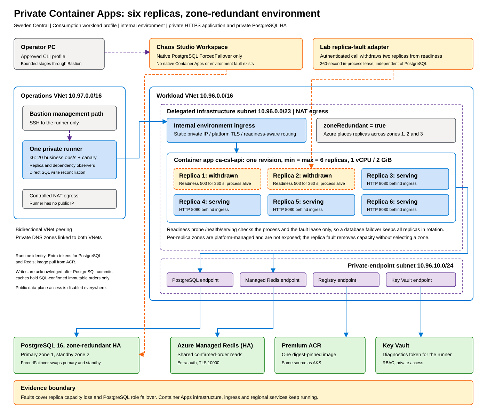

# Container Apps results

[Executive summary](executive-summary.md) | [Method](method.md) | Next: [AKS results](aks-results.md)

Container Apps runs containers in a managed environment without exposing nodes, and Chaos Studio has no Container Apps fault. The questions are therefore: does the platform stop routing to replicas that report themselves unhealthy, do the remaining replicas absorb the load, and how does the application behave when PostgreSQL fails over, alone or at the same time?

## Architecture

An internal Container Apps environment with `zoneRedundant=true` and the Consumption workload profile runs in a delegated /23 subnet in Sweden Central; a private DNS zone maps the environment's default domain to its static private IP. One container app runs six fixed replicas (1 vCPU, 2 GiB each) from a digest-pinned image in a private registry, and Azure spreads them across the three zones. The application is the cached .NET 10 build described in the [AKS results](aks-results.md). PostgreSQL 16 with zone-redundant HA, Azure Managed Redis, Key Vault and the registry sit behind private endpoints, with Entra authentication through one user-assigned identity.

## The replica fault

A Container Apps *readiness probe* tells the ingress whether a replica may receive traffic. Ours calls `/health/serving`, which checks the process and a lab *fault lease*: an in-memory flag, set through an authenticated endpoint, that makes the probe return 503 for a fixed time and then clears itself. The probe ignores PostgreSQL on purpose, so a database failover leaves every replica in rotation and the application handles database errors itself.

To remove capacity, the runner calls the fault endpoint until two distinct replicas have accepted a 360-second lease. With probes every 2 seconds and two failures required, those replicas leave rotation within seconds while their processes keep running and finish in-flight requests. Azure Resource Manager reports each replica's readiness, so an independent observer confirms which replicas were withdrawn and for how long.

## Results

The measurements ran on 11 November 2026.

| Phase | Successful business ops | Failed ops | Failed attempts, retried | Dropped | p95 | Recovery |
| --- | ---: | ---: | ---: | ---: | ---: | ---: |
| Baseline, 10 min | 12,001 | 0 | 0 | 0 | 28 ms | |
| Two of six replicas withdrawn, 18 min | 21,600 | 0 | 0 | 0 | 28 ms | |
| PostgreSQL forced failover, 18 min | 21,601 | 0 | 561 | 0 | 30 ms | 35.2 s |
| Failover plus replica withdrawal, 18 min | 21,601 | 0 | 350 | 0 | 29 ms | 27.6 s |

The observer saw both target replicas unready and the other four ready for 346 seconds, and no request in that interval was served by a withdrawn replica. Clients saw no failed attempt across the 18 minutes, and the first five minutes after the withdrawal had 100% success with a 29 ms p95.

During the failover the dependency probe returned 503 for about 35 seconds and 561 individual attempts failed, but each was retried until PostgreSQL confirmed it, while reads of confirmed orders kept coming from the caches. The primary moved between zones 1 and 2 in each failover and HA was healthy afterwards. In the combined case the replica withdrawal started while the database was failing over, with database errors observed immediately before and after it.

Reconciliation in PostgreSQL found all 20,689 acknowledged writes from these runs and their warmup, each with its expected checksum.
