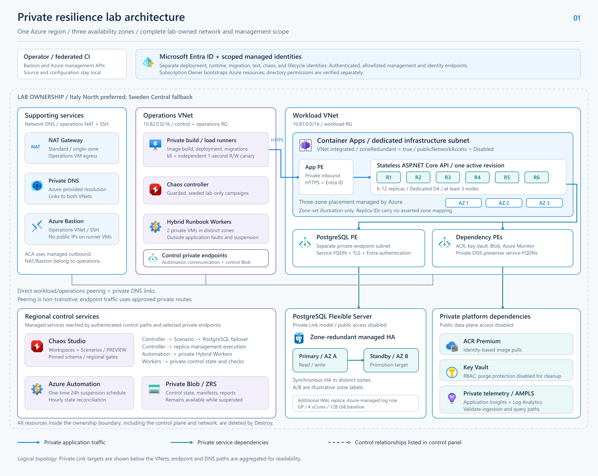
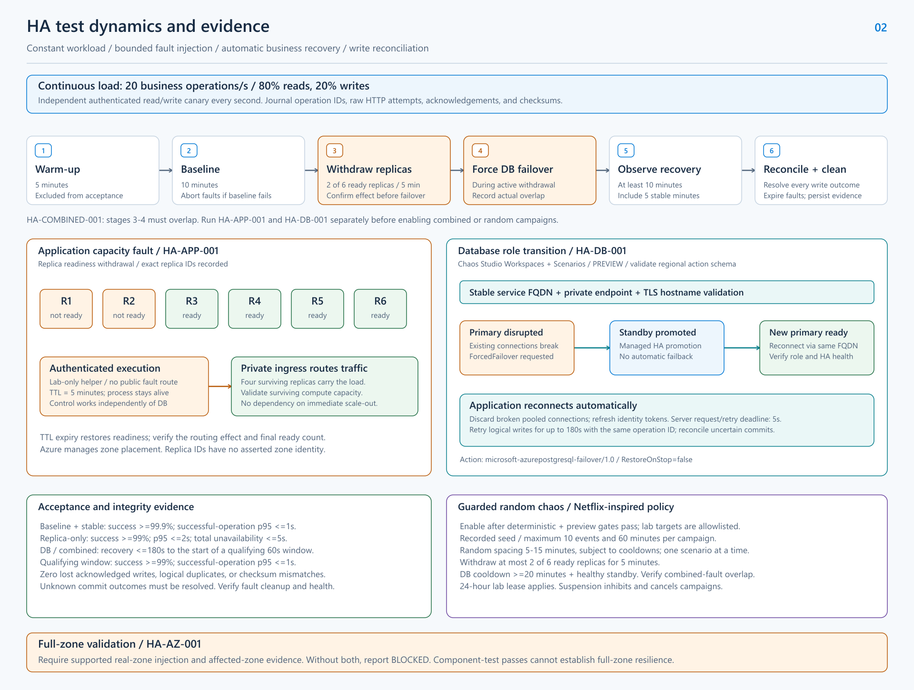
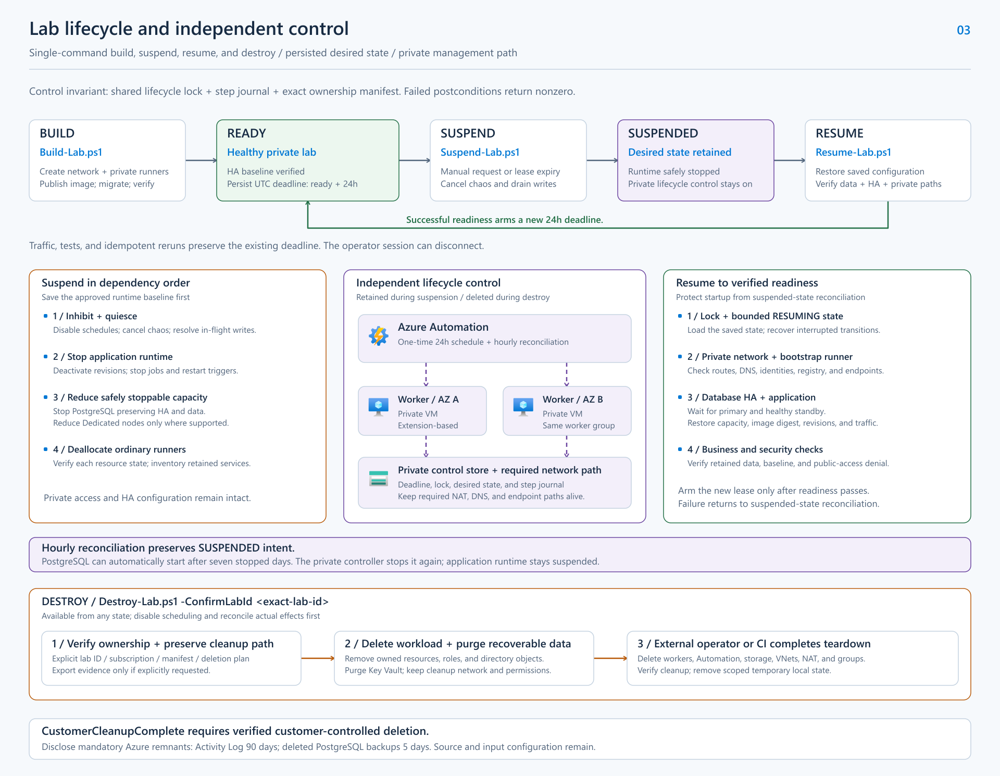

# Architecture and flow diagrams

## Current target and evidence contract

- [Private Linux App Service target architecture](04-private-linux-app-service.svg): managed six-worker plan, required three-zone participation, separate outbound Integration/inbound PE subnets, private application/SCM/database paths and one runner.
- [Deterministic native suite evidence contract](05-native-chaos-evidence.svg): independent baseline, exact-instance, zone-selected, database, combined and real-zone verdicts, including effect overlap and all-write durability.

These are editable SVG sources with generic labeled components. Placement is illustrative. The live workload is blocked by AZ-worker quota, and no runtime/fault acceptance is implied. Open the sources in Inkscape; export a PNG only when a preview is needed.

## Historical drawings

The three drawings below depict Container Apps and the previous Automation lifecycle. They remain historical artifacts. The [current specification](../specification.md) and current target/evidence diagrams above supersede their conflicting topology, fault and lifecycle content.

The SVG files are the editable sources. Open them directly in Inkscape. The PNG files provide previews for Markdown readers and sharing.

For a connected explanation of the components, request paths, test evidence, and lifecycle transitions shown here, read the [architecture and operating guide](../architecture-guide.md).

| Diagram | Editable SVG | PNG preview | Specification |
| --- | --- | --- | --- |
| Private architecture | [Open SVG](01-private-architecture.svg) | [Open PNG](01-private-architecture.png) | [Target architecture](../specification.md#2-target-architecture) |
| HA test dynamics | [Open SVG](02-ha-test-dynamics.svg) | [Open PNG](02-ha-test-dynamics.png) | [Experiments](../specification.md#4-experiment-catalog-and-evidence) and [measurements](../specification.md#5-workload-procedure-and-measurements) |
| Lab lifecycle | [Open SVG](03-lab-lifecycle.svg) | [Open PNG](03-lab-lifecycle.png) | [Lifecycle commands](../specification.md#8-lab-lifecycle-commands) |

## 1. Private architecture

Shows the two lab-owned VNets, private endpoints, and regional managed services. The supporting-services panel aggregates the network-group private DNS zones and operations-group NAT/Bastion. NAT and Bastion are hosted with operations; the panel is a logical grouping. Private-zone links serve both VNets through Azure-provided DNS, and direct bidirectional peering carries private cross-VNet traffic. No hub VNet, Azure Firewall, or appliance UDR is deployed.

Standard NAT is a single-zone management egress dependency outside the application request path; the diagram makes no claim of zone-redundant management connectivity.

Container Apps uses VNet integration and an environment private endpoint. Azure manages replica placement across zones. The zone badges show the available zone set; individual replica IDs have no asserted zone mapping.

PostgreSQL uses the Private Link-compatible model. Its primary and standby occupy distinct zones. Azure manages the additional WAL replica. Full database nodes and the log role have different responsibilities.

The control panel lists orchestration relationships. Azure Automation runs lifecycle code on the private Hybrid Workers. Those workers access private control storage and perform private checks.



## 2. HA test dynamics

Shows the combined test sequence and the separate readiness-withdrawal and database-failover mechanisms. Load and the independent canary continue during injection.

Actual database disruption must overlap the replica withdrawal for the combined scenario. Recovery is measured from observed disruption. Reports require write reconciliation and cleanup evidence.

Chaos Studio Workspaces and Scenarios carry a preview label. Their regional schema and behavior require validation. A full-zone verdict requires qualifying real-zone injection and affected-zone evidence.



## 3. Lab lifecycle

Shows build, verified readiness, suspension, resume, and destruction. Successful build or resume arms the 24-hour lease. Idempotent reruns preserve its existing deadline.

The two private Hybrid Workers, control storage, and required networking remain available during suspension. Hourly reconciliation stops PostgreSQL again after a platform-initiated restart.

Destroy removes the complete lab-owned environment, including networks and lifecycle control. Final deletion runs from the external operator or CI context. Mandatory Azure-retained records are disclosed.



## Editing and export

Each SVG contains five Inkscape layers: Background, Boundaries, Connectors, Components, and Labels. Text remains editable. Service icons are embedded vector groups with unique IDs. The files require no external images or icon-library paths.

After editing an SVG, regenerate its corresponding PNG with Inkscape. From this directory in PowerShell:

```powershell
& 'C:\Program Files\Inkscape\bin\inkscape.com' `
  '.\01-private-architecture.svg' `
  '--export-type=png' `
  '--export-filename=.\01-private-architecture.png'
```

Use the corresponding filename for the other diagrams. Preserve the service icons' shape, colors, and proportions.

## Icon provenance

Service icons come from the supplied local Azure Public Service Icons collection. Their original artwork is embedded in the SVGs. Microsoft publishes the [Azure architecture icons and usage terms](https://learn.microsoft.com/en-us/azure/architecture/icons/). The diagrams illustrate the services in accordance with that architectural use.

The historical drawings follow the earlier specification preserved at Git tag `baseline-before-app-service-refactor`. The [current specification](../specification.md) and [D17-D19](../../DECISIONS-ACCEPTED.md#d17-private-azure-app-service-across-three-zones) define their required replacement.
