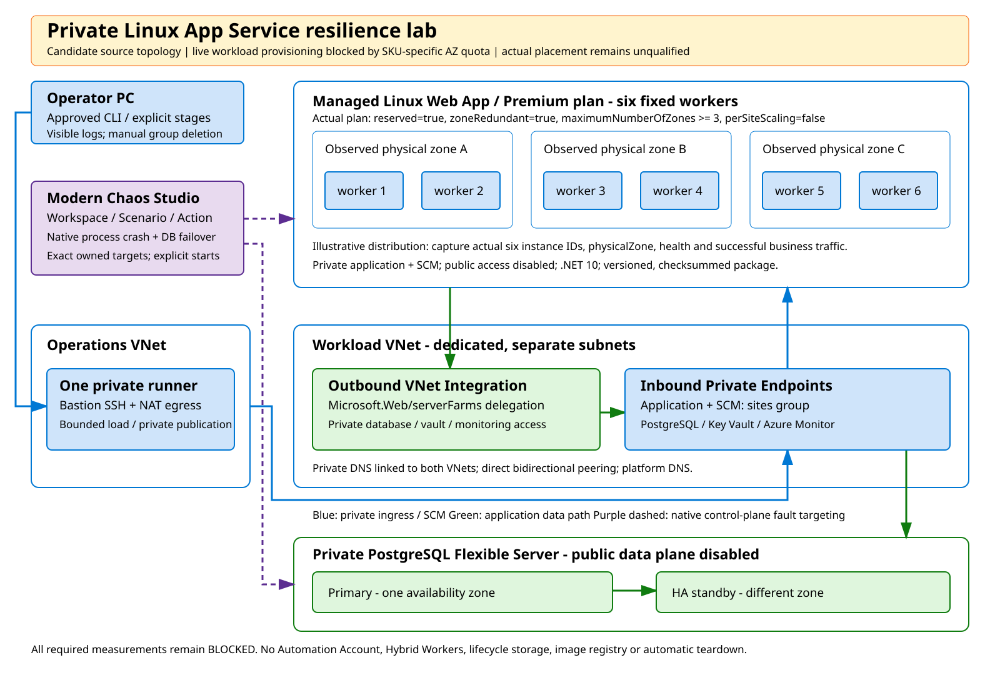
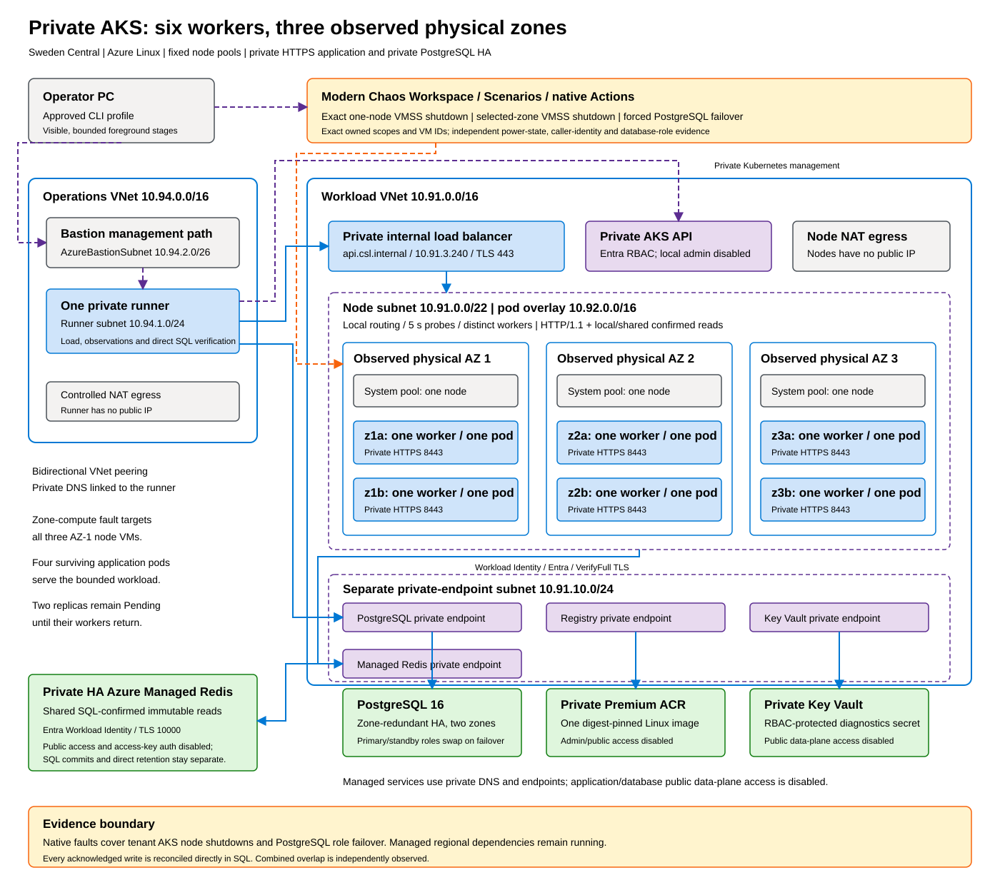
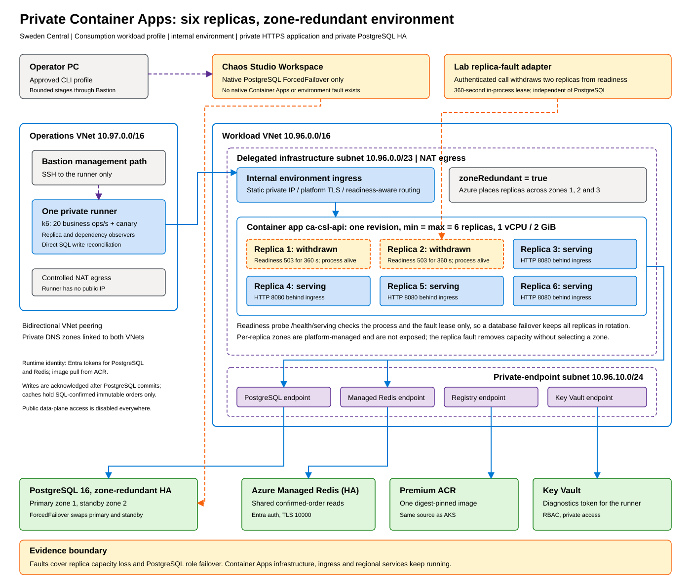

# Executive summary: HA and DR with Azure Chaos Studio

[README](../README.md) | Details: [Method](method.md) · [App Service](app-service-results.md) · [AKS](aks-results.md) · [Container Apps](container-apps-results.md)

The goal was to use Azure Chaos Studio to test *high availability* (HA), the ability to keep serving or recover automatically when a component fails, and *disaster recovery* (DR), the ability to restore service and data after a broader loss. We ran one order API, which acknowledges a write only after PostgreSQL commits it, on three Azure platforms between 4 and 11 November 2026, under the same load and with the same measurements.

## 1. Conclusion

All three platforms kept serving through the loss of application capacity, and no acknowledged write was lost in any reported run: 22,424 on App Service, 68,245 on AKS and 20,689 on Container Apps. The decisive factor for database failover was the application design. Without a cache, App Service lost 2.7% of business operations, failed or dropped, during the 18-minute failover phase. With SQL-confirmed caching and idempotent retries, no business operation failed on AKS or Container Apps. On AKS the load generator still dropped 51 scheduled operations while it was creating virtual users; on Container Apps, with virtual users preallocated, business success was 100%.

Container Apps reached 100% business success in every case. On AKS the best compute results and the best database result come from two successive versions of the application, and the combined fault was measured only on the first version.

DR was outside the scope: the lab ran no regional failover or backup restore. The results describe HA for the specific faults we injected.

## 2. The three architectures

Every platform used the same private design: a private runner generating load, private ingress, PostgreSQL 16 with zone-redundant HA, Key Vault and the registry behind private endpoints, and Entra identities instead of passwords.

**App Service** ran six P1v3 workers, two per zone, with Private Endpoint ingress and VNet Integration egress, and no read cache. Linux rejected Chaos Studio's process fault, so the tests used a Windows variant.

**AKS** ran six pods on six single-node pools, two per zone, behind an internal load balancer with node-local routing. Chaos Studio could shut down one exact node or all lab nodes in one zone. Reads of confirmed orders used a per-pod cache and a shared Azure Managed Redis.

**Container Apps** ran six fixed replicas in an internal zone-redundant environment, with the AKS application and caches unchanged. Chaos Studio has no Container Apps fault, so a lab adapter withdrew replicas from readiness.

## 3. Results

Business success is measured over the whole fault phase: 12 minutes for the App Service process kills, 18 minutes otherwise. Recovery is the time from the first observed database error to the first full minute with at least 99% success.

| Fault | App Service (Windows) | AKS | Container Apps |
| --- | --- | --- | --- |
| Application capacity | Process kill on one worker, or on both workers of one zone: 100% | Shutdown of one node / of all zone-1 lab nodes: 99.96% / 99.95%; first five minutes 100% | 2 of 6 replicas withdrawn for 346 s: 100% |
| PostgreSQL failover | 97.35%, recovery 36 s | 99.76% (0 failed, 51 dropped), recovery 27 s | 100%, recovery 35 s |
| Failover plus capacity fault | 97.32%, recovery 35 s | 97.44%, recovery 29 s (first version, without cache) | 100%, recovery 28 s |
| Acknowledged writes lost | 0 of 22,424 | 0 of 68,245 | 0 of 20,689 |

Two facts are needed to read this table fairly. First, the database results compare application designs more than platforms: AKS and Container Apps ran the cached build that the AKS investigation produced, while App Service ran without a cache. Second, the capacity faults differ in severity. A node shutdown on AKS removes a host abruptly and is the strongest test; a process kill on App Service and a readiness withdrawal on Container Apps leave the host running, and the withdrawal also lets in-flight requests finish.

## 4. Where Chaos Studio helped

Chaos Studio's native faults gave repeatable, precisely targeted tests: the PostgreSQL forced failover on every platform, VMSS shutdown on AKS, and process kill on Windows App Service. Combined with independent observation, they exposed real weaknesses that healthy dashboards hid: HTTP/2 connections lingering on dead AKS nodes, pods doubling up on one node, cold caches during failover, and load generators creating virtual users too late.

Coverage has two gaps. Linux App Service could not run the process fault, and Container Apps has no native fault, so its capacity test relied on our own readiness adapter.

## 5. HA, DR and next steps

The evidence supports these HA conclusions: losing a third of application capacity, one node or one zone's compute costs at most 11 of 21,600 business operations when capacity is pre-provisioned and routing follows health; a PostgreSQL zone-redundant failover recovers within 27–36 seconds without data loss; and SQL-confirmed caching with idempotent retries hides that failover from the business workload.

A DR exercise needs a separate design: a recovery region or restore target, data replication or backup, traffic redirection, and measured RTO and RPO. The next HA steps are an abrupt replica-crash test on Container Apps, a single-version AKS rerun of all faults, and a cache-outage test now that both container platforms depend on Redis.
